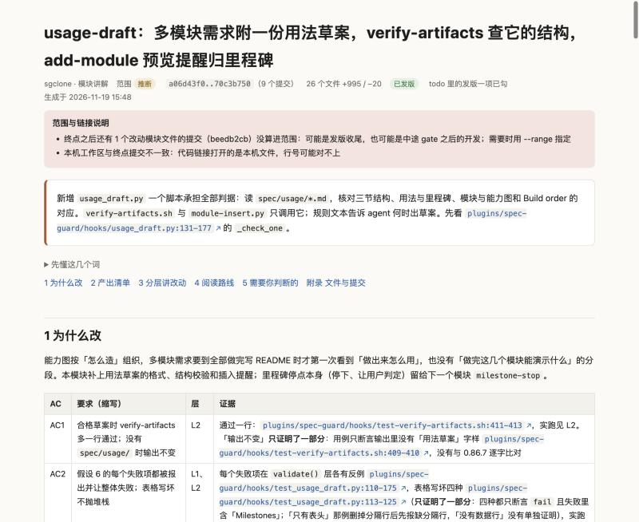

# delivery-brief（交付讲解）

AI 写的代码越来越多，人看代码的时间越来越少：测试都过了，但这次到底造了什么、为什么这样造、怎么串起来、哪里要人判断，
往往说不清。delivery-brief 是一个 Claude Code 插件，在你需要的时候用一个命令生成一份**本机讲解网页**，几分钟看懂一个模块或一段提交。



讲解页回答固定的六个问题，讲法随内容和项目类型变化：

1. **为什么改**：对应哪几条验收标准（AC），每条的证据是测试断言、代码行或实跑输出；有用法草案时对照计划与实际。
2. **产出清单**：按项目类型分组（前端的页面、组件、hooks；后端的模块、公开函数；插件的命令、脚本、规则……），每项写新增还是修改、做什么、怎么用、代码位置。
3. **分层讲改动**：按意图分 3～7 层，值得画图的才画。
4. **阅读路线**：看哪 3～7 处代码、按什么顺序。
5. **需要你判断的**：偏离计划、取舍、没测到的部分、出错时不会如实报告的边界。只摆事实，不打分。
6. **附录**：逐文件的改动表与提交表。

页头和附录里的数字（提交数、文件数、增删行）由脚本直接从 git 生成，不经模型；正文里每条证据都带引用，生成后由检查脚本核对引用真实存在。

## 安装

需要 Claude Code、`git`、`python3`（3.9 及以上，只用标准库）。`gh` 可选（用来判断能不能生成 GitHub 行号链接）；
[delegate](https://github.com/haigeerlab/delegate-plugin) 插件可选（`--cross-check` 要用）。

```text
/plugin marketplace add haigeerlab/delivery-brief
/plugin install delivery-brief@delivery-brief-marketplace
```

## 用法

```text
/delivery-brief:brief <模块 id>          # spec-guard 项目里讲一个模块，提交范围自动推断
/delivery-brief:brief <base>..<head>     # 讲任意一段提交，任何 git 项目都行
```

| 参数 | 作用 |
|---|---|
| `--project <dir>` | 被讲解的项目，缺省为当前目录所在的 git 仓库 |
| `--no-open` | 生成后不自动用浏览器打开 |
| `--cross-check` | 讲解生成后，经 delegate 交给另一个模型只读核对：说法与代码是否相符、有没有漏掉的事实；每条发现回到代码核实后再改讲解，附录留核对记录。另花约 10～25 万输入 token（delegate 默认后端的额度） |

生成前会先告诉你范围、来源和规模；diff 超过约 5 万 token 时先停下问你。

**输出位置**：`~/.claude/delivery-brief/<项目目录名>/<模块 id>.html`，旁边是讲解源文件（`.md`）与事实（`.facts.json`）。
**不写被讲解项目的任何文件**；需要实跑测试时，只在 `git archive` 导出的临时目录里跑。讲解页不需要维护，随时可以重生成，同名会覆盖。

## 模块范围怎么来的

在 [spec-guard](https://github.com/haigeerlab/spec-guard-plugin) 项目里，按它公开的文件约定推断：起点是第一个改动
`spec/<id>.md` 或 `tasks/<id>/` 的提交，终点是把 todo 里最后一个「（gate）」检查点勾上的提交。页头会标「推断」，
可疑的地方（终点之后还有改模块文件的提交、混入别的模块的提交）列在页头提示里。推断不准时用 `<base>..<head>` 指定。
规则与已知局限见 [docs/facts-schema.md](docs/facts-schema.md)。

## 不做什么

- 不给代码质量打分，判断留给人；讲解只负责把要判断的地方摆出来。
- 不替代独立的代码审查（`--cross-check` 核对的是讲解是否属实，不是代码好不好）。
- 讲解页不进被讲解项目的仓库。

## 0.1.1 修了什么

0.1.0 用 `--cross-check` 给 brief-facts 自己生成讲解时查出的问题，0.1.1 已修：

- 仓库里有不是 UTF-8 的文件路径时，不再抛 Python 堆栈：照常收集，不能识别的字节显示成 �，并在页头提示里列出。
- 查终点提交是否在远端时，分开报「不在远端」和「gh 查询失败（网络、权限、限流）」。
- 模块的 todo 或用法草案读不到时，写进页头提示，不再静默跳过。
- 验收之后只改了代码、没改 spec／tasks 文件的提交，在页头提示里列出（不算进范围）。

## 开发

```text
python3 -B -m unittest discover -s plugins/delivery-brief/tests
claude plugin validate .
```

讲法的规格在 [`plugins/delivery-brief/references/brief-rules.md`](plugins/delivery-brief/references/brief-rules.md)，
流程在 [`plugins/delivery-brief/commands/brief.md`](plugins/delivery-brief/commands/brief.md)。
本仓库用 spec-guard 开发，需求与计划在 `spec/` 和 `tasks/`。

后续计划：有界面改动时自动截图（ui-screenshots）、里程碑讲解页（milestone-brief）。

## 许可证

MIT，见 [LICENSE](LICENSE)。
